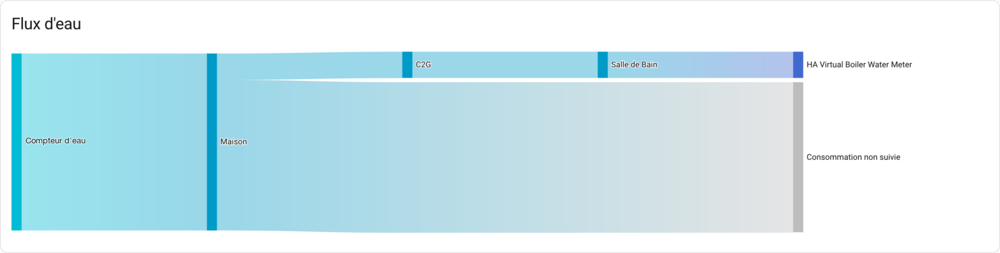

# HA Virtual Boiler Water Meter

[🇬🇧 English version](README.md)

Intégration [Home Assistant](https://www.home-assistant.io/) qui estime la **consommation d'eau chaude sanitaire (en m³)** à partir de l'énergie de chauffe du ballon d'eau chaude, sans compteur d'eau dédié. L'entité produite est directement utilisable dans la section **Eau** du tableau Énergie de Home Assistant.



*Exemple : l'eau chaude estimée affichée comme consommateur dans le flux d'eau du tableau Énergie.*

## Principe

Chauffer 1 litre d'eau de 1 °C requiert 1,163 Wh. L'énergie électrique de chauffe, corrigée des pertes en veille et du COP, donne donc le volume d'eau chaude tiré :

```
Volume (L) = (E_chauffe(Wh) − pertes(Wh)) × COP ÷ (1,163 × (T_ballon − T_eau_froide)) × calibration
```

## Configuration

Le formulaire s'affiche à l'ajout de l'intégration. Tous les champs, sauf le type et le capteur source, restent modifiables ensuite via **Configurer** sur la carte de l'intégration.

| Champ dans le formulaire | En bref | Défaut |
|---|---|---|
| Type de capteur source | `power` (puissance instantanée) ou `energy` (compteur d'énergie cumulée) | `power` |
| Capteur source (puissance ou énergie) | Le capteur qui mesure la consommation du chauffe-eau | obligatoire |
| Capteur de température du ballon (optionnel) | Température réelle du ballon, si vous en avez une | — |
| Température du ballon par défaut (°C) | Utilisée sans capteur ou s'il est indisponible | 45 °C |
| Capteur de température d'eau froide (optionnel) | Température de l'eau qui entre dans le ballon | — |
| Température d'eau froide (°C) | Utilisée sans capteur ou s'il est indisponible | 13 °C |
| Pertes en veille (Wh/jour) | Énergie que le ballon perd sans qu'on tire d'eau | 0 |
| COP (1 = résistif, 2–3 = thermodynamique) | Rendement du chauffe-eau | 1 |
| Facteur de calibration | Correction finale après comparaison avec une mesure réelle | 1 |

### Source d'énergie

- **Type de capteur source** : choisissez `energy` si vous avez un compteur cumulé en Wh ou kWh (celui que vous utilisez dans le tableau Énergie par exemple). C'est le plus fiable : rien n'est perdu entre deux mises à jour ni après un redémarrage. Choisissez `power` si vous n'avez qu'un capteur de puissance en W ou kW ; l'intégration calcule alors l'énergie elle-même.
- **Capteur source** : il doit mesurer **uniquement le chauffe-eau** (prise ou module connecté, pince ampèremétrique sur son circuit, sortie dédiée d'un compteur Linky…). Un capteur de toute la maison donnerait un volume absurde.

> Le type et le capteur source ne sont plus modifiables après la création, pour ne pas fausser le cumul. Pour en changer, supprimez puis recréez l'intégration.

### Températures

Le volume dépend directement de l'écart entre la température du ballon et celle de l'eau froide : plus l'écart est petit, plus le volume estimé est grand. Ces deux valeurs comptent donc beaucoup.

- **Température du ballon** : si vous avez une sonde ou une entité `water_heater` (sa `current_temperature` est lue), sélectionnez-la. Sinon, mettez dans la constante la **consigne du thermostat** du ballon, souvent entre 55 et 65 °C. Le défaut de 45 °C convient surtout aux ballons réglés bas.
- **Température d'eau froide** : celle de l'eau du réseau à l'arrivée du ballon. Elle varie avec les saisons, à peu près de 8–10 °C en hiver à 15–20 °C en été. Sans capteur, pensez à ajuster la constante deux ou trois fois par an.

### Pertes en veille

Un ballon perd de la chaleur en permanence, et se réchauffe même quand personne ne tire d'eau. Sans correction, ces réchauffes sont comptées comme de l'eau consommée. Ce champ indique l'énergie perdue par jour ; elle est déduite de chaque chauffe.

Pour l'estimer, par ordre de préférence :

1. **Mesure directe** : relevez l'énergie consommée par le ballon sur une journée sans tirage (absence, vacances). Ce chiffre en Wh correspond à vos pertes.
2. **Fiche technique** : les « pertes statiques » sont souvent données en kWh/24 h (× 1000 pour des Wh) ou en W (× 24 pour des Wh/jour).
3. **Calcul** : laissez le ballon chaud sans tirer d'eau pendant la nuit et notez la baisse de température. Pertes (Wh/jour) = volume du ballon (L) × 1,163 × baisse par heure (°C) × 24. Par exemple, 200 L qui perdent 0,3 °C/h : 200 × 1,163 × 0,3 × 24 ≈ 1 700 Wh/jour.

Ordre de grandeur pour un ballon de 150–200 L : 1 000 à 2 000 Wh/jour. Dans le doute, restez en dessous de la valeur réelle : si vous la surestimez, les petits tirages ne sont plus comptés.

### COP

L'énergie électrique est multipliée par ce coefficient pour obtenir la chaleur réellement fournie à l'eau. Laissez **1** pour un chauffe-eau électrique classique (résistance). Pour un chauffe-eau **thermodynamique**, prenez le COP de sa fiche technique, en général entre 2,5 et 3,5.

### Calibration

Un facteur multiplicatif appliqué à la fin, pour corriger l'écart restant. Laissez 1 au début. Après une ou deux semaines, comparez avec un volume connu (compteur d'eau chaude, ou tirages mesurés à la main) et appliquez :

`nouveau facteur = facteur actuel × volume réel ÷ volume estimé`

Par exemple, 1,2 m³ réels pour 1,0 m³ estimé avec un facteur de 1 : passez à 1,2.

Pour vérifier les valeurs utilisées, ouvrez l'entité : ses attributs affichent la température du ballon et de l'eau froide retenues, le COP, la calibration et le total en litres.

## Installation (test local)

1. Copiez le dossier `custom_components/ha_virtual_boiler_water_meter/` dans `/config/custom_components/` de Home Assistant.
2. Redémarrez Home Assistant.
3. Paramètres → Appareils et services → **Ajouter une intégration** → cherchez « HA Virtual Boiler Water Meter ».
4. Renseignez les champs (voir [Configuration](#configuration)).
5. Ajoutez l'entité `sensor.eau_chaude_estimee` dans Paramètres → Tableaux de bord → Énergie → section **Eau**.

Pour l'estimation journalière, ajoutez dans `configuration.yaml` :

```yaml
utility_meter:
  compteur_eau_chaude_journalier:
    source: sensor.eau_chaude_estimee
    cycle: daily
```

## Précision et limites

- Précision typique : **±15–20 %** (température d'entrée estimée, stratification du ballon, lissage des pertes).
- Prévu pour un chauffe-eau **résistif** ; pour un ballon thermodynamique, renseignez le COP (>1).
- L'estimation est cumulative depuis l'installation ; utilisez `utility_meter` pour les périodes.
- Ne remplace pas un compteur d'eau physique pour un usage facturable.

## Licence

MIT — utilisez, modifiez, republiez librement.
