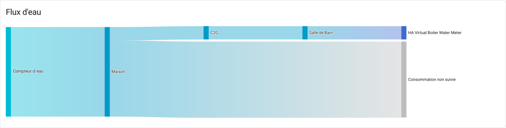

# HA Virtual Boiler Water Meter

[🇫🇷 Version française](README.fr.md)

[Home Assistant](https://www.home-assistant.io/) integration that estimates **hot water consumption (in m³)** from the heating energy of a hot water tank, without a dedicated water meter. The generated entity can be directly used in the **Water** section of Home Assistant's Energy dashboard.



*Example: the estimated hot water shown as a consumer in the Energy dashboard's water flow.*

## Principle

Heating 1 litre of water by 1 °C requires 1.163 Wh. The electrical heating energy, corrected for standby losses and COP, gives the volume of hot water drawn:

```
Volume (L) = (E_heating(Wh) − losses(Wh)) × COP ÷ (1.163 × (T_tank − T_cold_water)) × calibration
```

## Configuration

The form appears when you add the integration. Every field except the source type and source sensor can be changed later via **Configure** on the integration card.

| Field in the form | In short | Default |
|---|---|---|
| Source sensor type | `power` (instantaneous power) or `energy` (cumulative energy counter) | `power` |
| Source sensor (power or energy) | The sensor measuring the water heater's consumption | required |
| Tank temperature sensor (optional) | Actual tank temperature, if you have one | — |
| Default tank temperature (°C) | Used without a sensor, or when it is unavailable | 45 °C |
| Cold water temperature sensor (optional) | Temperature of the water entering the tank | — |
| Cold water temperature (°C) | Used without a sensor, or when it is unavailable | 13 °C |
| Standby heat loss (Wh/day) | Energy the tank loses when no water is drawn | 0 |
| COP (1 resistive, 2-3 heat pump) | Efficiency of the water heater | 1 |
| Calibration factor | Final correction after comparing with a real measurement | 1 |

### Energy source

- **Source sensor type**: pick `energy` if you have a cumulative counter in Wh or kWh (for example the one you use in the Energy dashboard). It is the most reliable: nothing is lost between updates or across restarts. Pick `power` if you only have a power sensor in W or kW; the integration then computes the energy itself.
- **Source sensor**: it must measure **only the water heater** (smart plug or relay, clamp meter on its circuit, dedicated output of your electricity meter…). A whole-house sensor would give a meaningless volume.

> The source type and sensor cannot be changed after creation, so the running total stays consistent. To change them, delete and re-add the integration.

### Temperatures

The volume depends directly on the gap between the tank temperature and the cold water temperature: the smaller the gap, the larger the estimated volume. Both values matter a lot.

- **Tank temperature**: if you have a probe or a `water_heater` entity (its `current_temperature` is read), select it. Otherwise, set the constant to the tank's **thermostat setpoint**, often 55–65 °C. The 45 °C default mostly suits tanks set low.
- **Cold water temperature**: the mains water temperature at the tank inlet. It changes with the seasons, roughly 8–10 °C in winter to 15–20 °C in summer. Without a sensor, adjust the constant two or three times a year.

### Standby heat loss

A tank constantly loses heat and reheats even when nobody draws water. Without a correction, those reheats are counted as water used. This field is the energy lost per day; it is deducted from each heating cycle.

To estimate it, in order of preference:

1. **Direct measurement**: read the energy used by the tank over a day with no draw (when you are away). That figure in Wh is your loss.
2. **Datasheet**: "standby losses" are often given in kWh/24 h (× 1000 for Wh) or in W (× 24 for Wh/day).
3. **Calculation**: leave the tank hot overnight with no draw and note the temperature drop. Loss (Wh/day) = tank volume (L) × 1.163 × drop per hour (°C) × 24. For example, 200 L losing 0.3 °C/h: 200 × 1.163 × 0.3 × 24 ≈ 1,700 Wh/day.

Typical range for a 150–200 L tank: 1,000 to 2,000 Wh/day. When unsure, stay below the real value: overestimating it makes small draws go uncounted.

### COP

The electrical energy is multiplied by this coefficient to get the heat actually delivered to the water. Keep **1** for a standard electric (resistive) water heater. For a **heat pump** water heater, use the COP from its datasheet, usually between 2.5 and 3.5.

### Calibration

A multiplier applied at the end to correct any remaining gap. Start at 1. After a week or two, compare with a known volume (hot water meter, or draws measured by hand) and apply:

`new factor = current factor × real volume ÷ estimated volume`

For example, 1.2 m³ real for 1.0 m³ estimated with a factor of 1: set it to 1.2.

To check the values in use, open the entity: its attributes show the tank and cold water temperatures applied, the COP, the calibration and the total in litres.

## Installation (Local Testing)

1. Copy the `custom_components/ha_virtual_boiler_water_meter/` folder to `/config/custom_components/` in Home Assistant.
2. Restart Home Assistant.
3. Settings → Devices and Services → **Add Integration** → search for "HA Virtual Boiler Water Meter".
4. Fill in the fields (see [Configuration](#configuration)).
5. Add the `sensor.eau_chaude_estimee` entity in Settings → Dashboards → Energy → **Water** section.

For daily estimation, add to `configuration.yaml`:

```yaml
utility_meter:
  hot_water_meter_daily:
    source: sensor.eau_chaude_estimee
    cycle: daily
```

## Accuracy and Limitations

- Typical accuracy: **±15–20 %** (estimated inlet temperature, tank stratification, loss smoothing).
- Designed for **resistive** water heaters; for heat pump tanks, set the COP (>1).
- Estimation is cumulative since installation; use `utility_meter` for time periods.
- Does not replace a physical water meter for billing purposes.

## License

MIT — use, modify, republish freely.
